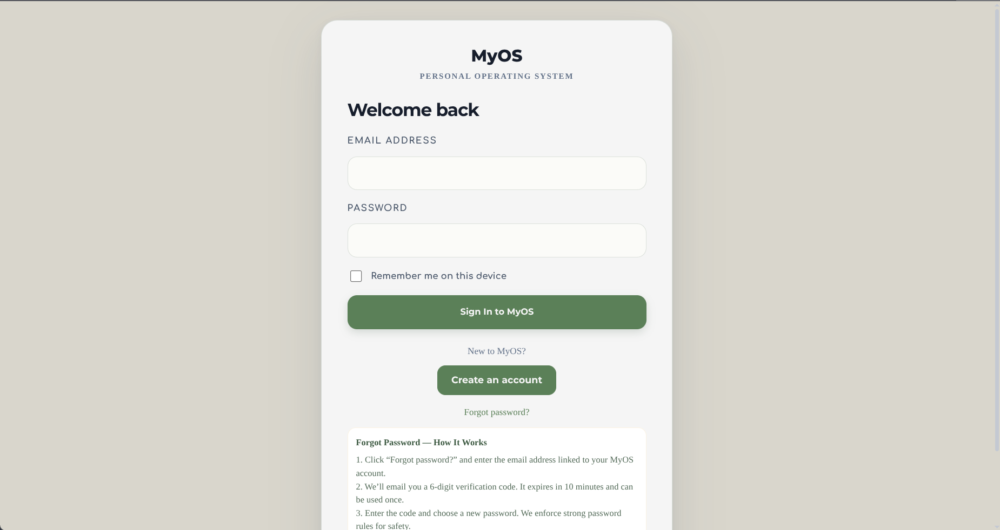
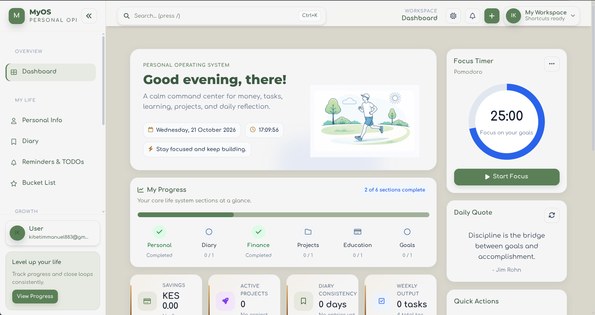
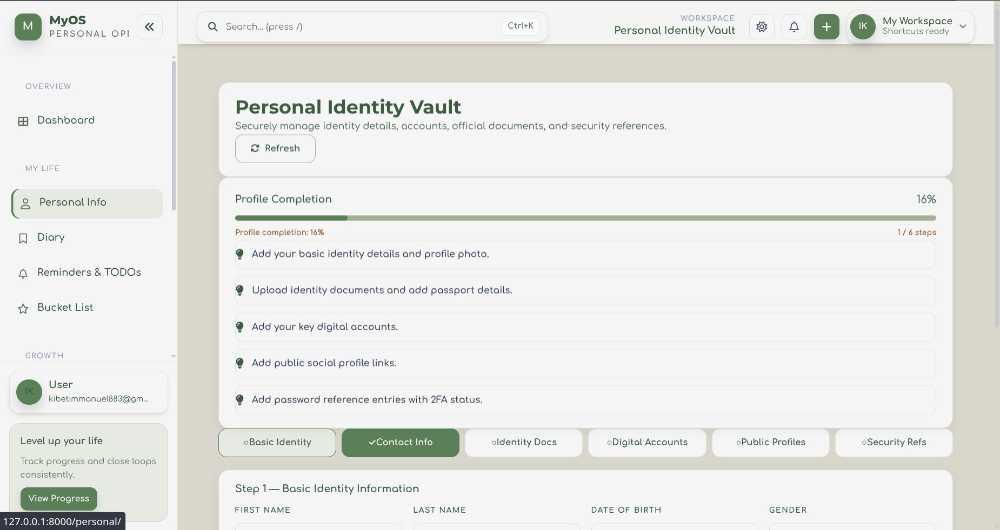
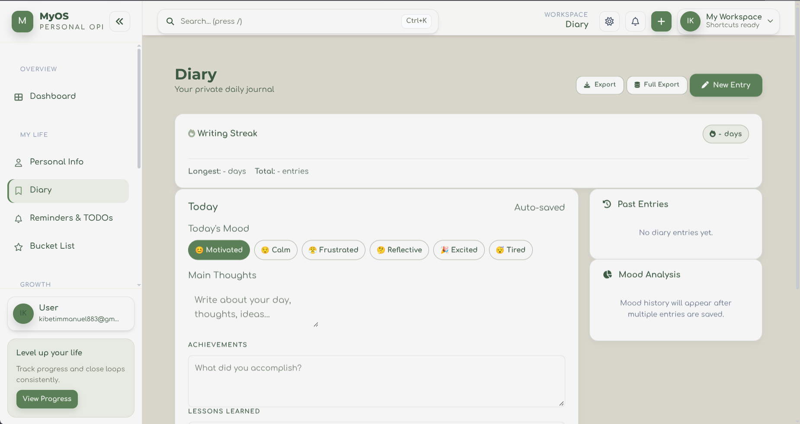
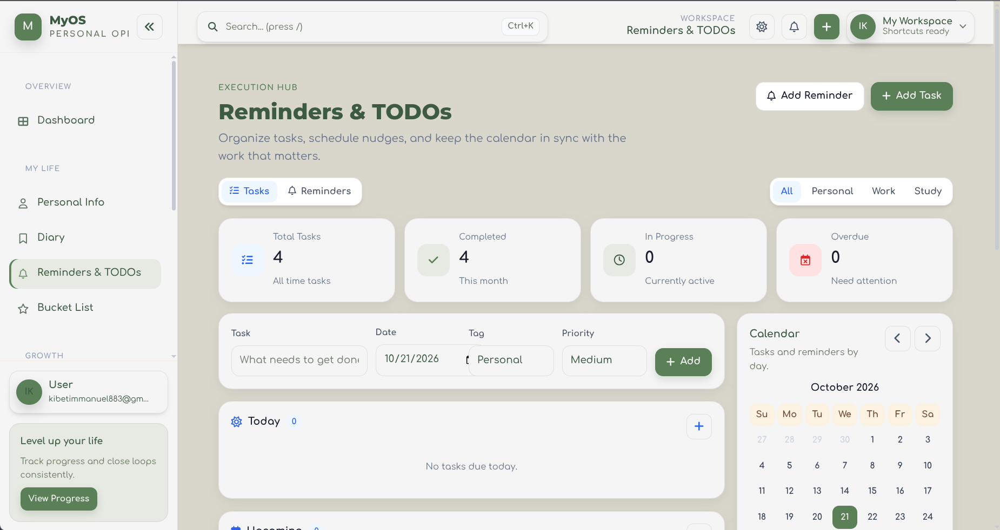
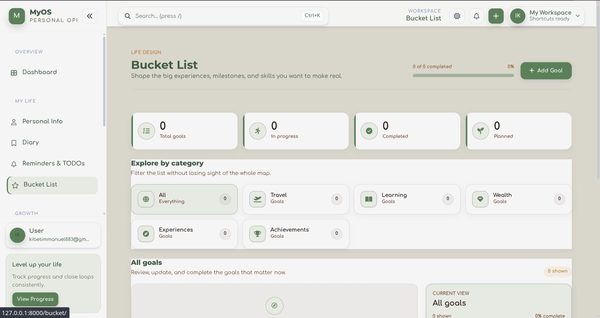
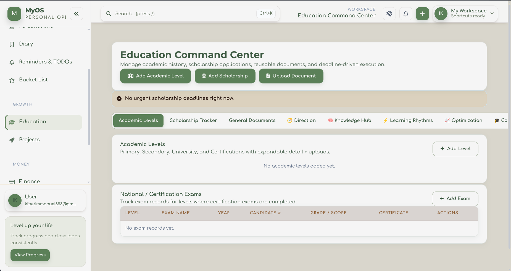
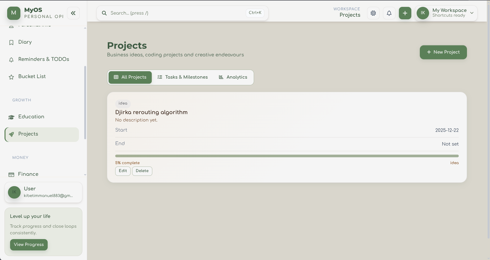
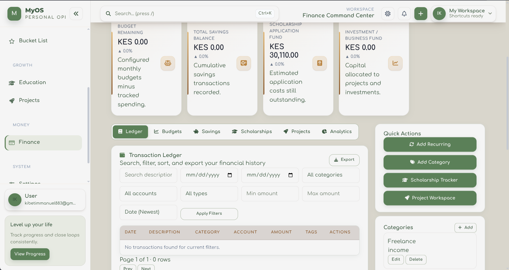

# MyOS

MyOS is a personal operating system for keeping everyday life in one place. The Django web app brings together a dashboard, personal identity vault, diary, reminders, bucket list, education tracker, projects, and finance tools. The repository also contains a separate Django REST API backend.

## Preview

### Sign in



### Dashboard



### Personal workspace

| Personal vault | Diary | Reminders |
| --- | --- | --- |
|  |  |  |

### Goals and growth

| Bucket list | Education | Projects | Finance |
| --- | --- | --- | --- |
|  |  |  |  |

Screenshots are stored in [`docs/screenshots/`](docs/screenshots/) so they remain available when the repository is moved or shared.

## How To Run the web application locally

The main server-rendered web app is in `myos_project/`:

```bash
cd myos_project
python3 -m venv .venv
source .venv/bin/activate
python -m pip install -r requirements.txt
cp .env.example .env  # skip if you already have a configured .env
python manage.py migrate
python manage.py runserver
```

Open [http://127.0.0.1:8000/](http://127.0.0.1:8000/). The site root displays the sign-in page; use **Create an account** to register. Set a private `SECRET_KEY` in `.env` before using real data. The default local database is SQLite.

## Repository map

```text
.
├── README.md                         # Project overview, screenshots, and setup
├── docs/screenshots/                 # UI preview images used above
├── myos_project/                     # Server-rendered Django web application
│   ├── manage.py                     # Django command entry point
│   ├── myos_project/                 # Web app settings and root URL routing
│   ├── accounts/                     # Registration, sign-in, sessions, and account security
│   ├── myos_app/                     # Main pages, life-management models, APIs, templates, and assets
│   ├── media_tracker/                # Personal media tracker feature
│   ├── requirements.txt              # Web app Python dependencies
│   └── .env.example                  # Example local configuration
└── myos_backend/                     # Separate REST API Django project
    ├── manage.py                     # API backend command entry point
    ├── config/                       # API settings, URLs, ASGI/WSGI, and runtime configuration
    ├── apps/                         # Modular API domains and shared services
    ├── analytics/                    # Cross-domain analytics helpers
    ├── requirements.txt              # API backend Python dependencies
    └── README.md                     # API backend setup and details
```

### Main web app files

- `myos_project/myos_project/settings.py` configures Django, middleware, database, templates, and static/media paths.
- `myos_project/myos_project/urls.py` maps the root login page, account routes, feature pages, and APIs.
- `myos_project/accounts/` contains the custom account model, forms, views, authentication middleware, and account templates.
- `myos_project/myos_app/models.py` defines profile, diary, finance, education, project, vault, and other personal records.
- `myos_project/myos_app/views.py` contains page handlers and JSON endpoints for the main application.
- `myos_project/myos_app/templates/` contains the server-rendered page templates.
- `myos_project/myos_app/static/` contains the site stylesheets, JavaScript, fonts, and visual assets.
- `myos_project/media_tracker/` contains the media feature’s data models, views, forms, and analytics.
- `myos_project/myos_app/migrations/` and each app’s `migrations/` directory track database schema changes.

## API backend

The REST API is maintained as a separate Django project under `myos_backend/`. Its modular apps provide user, finance, diary, projects, education, media, bucket-list, notification, and event APIs. Follow [`myos_backend/README.md`](myos_backend/README.md) for its local setup and environment-key configuration.
